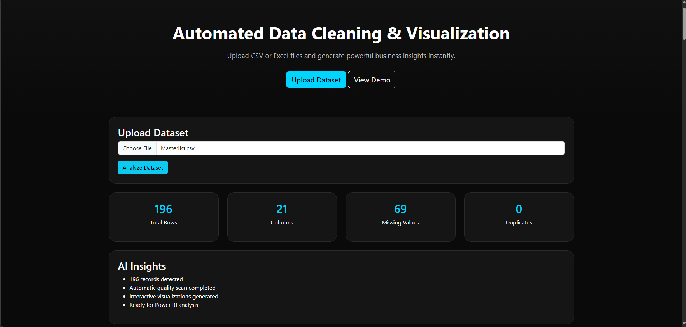
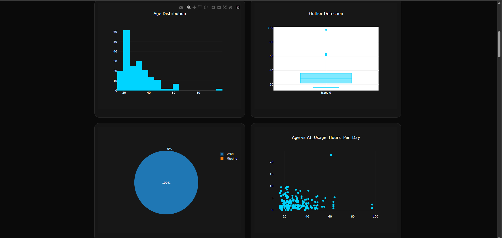
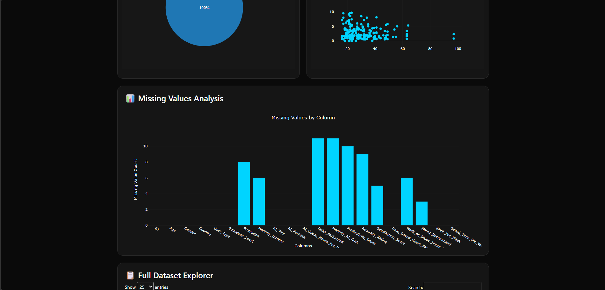
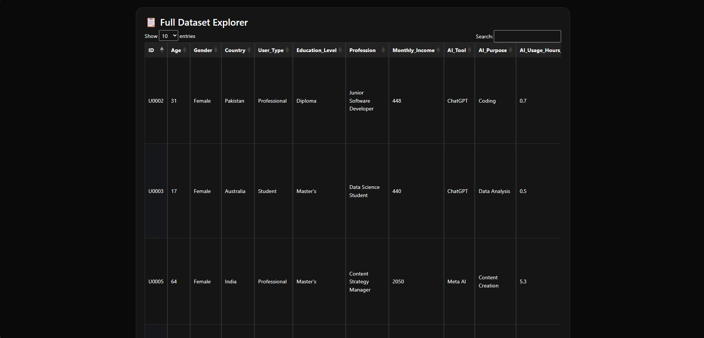

# DataPilot-Analytics-Dashboard
DataPilot Analytics Dashboard is a web-based data quality and visualization platform designed to automate the initial stages of data analysis. The application enables users to upload CSV and Excel datasets, perform automated data quality assessments, and generate interactive visualizations for exploratory data analysis.

Key Features

- Upload and analyze CSV, XLS, and XLSX files
- Automated data profiling and dataset overview
- Missing value analysis by column
- Duplicate record detection
- Interactive data quality dashboard
- Dynamic visualizations including: 
- Histograms
- Scatter Plots
- Box Plots
- Pie Charts
- Data Quality Charts
- Searchable and filterable data explorer table
- Executive summary report generation
- Modern dark-themed user interface
- Responsive dashboard design
Business Value
DataPilot helps analysts quickly understand data quality issues before performing advanced analysis, reporting, or machine learning. By automating exploratory data analysis and data quality monitoring, users can spend less time preparing data and more time generating business insights.
Technologies Used

- HTML5
- CSS3
- JavaScript (ES6)
- Bootstrap 5
- Plotly.js
- DataTables.js
- PapaParse
- SheetJS (xlsx)

Project Objective
The objective of this project is to showcase data analytics, data quality assessment, dashboard development, and front-end visualization skills while applying concepts commonly used in real-world business intelligence and data analysis environments.
This project was developed as part of a Data Analyst portfolio to demonstrate practical experience in data cleaning, exploratory data analysis (EDA), dashboard design, and reporting automation.

